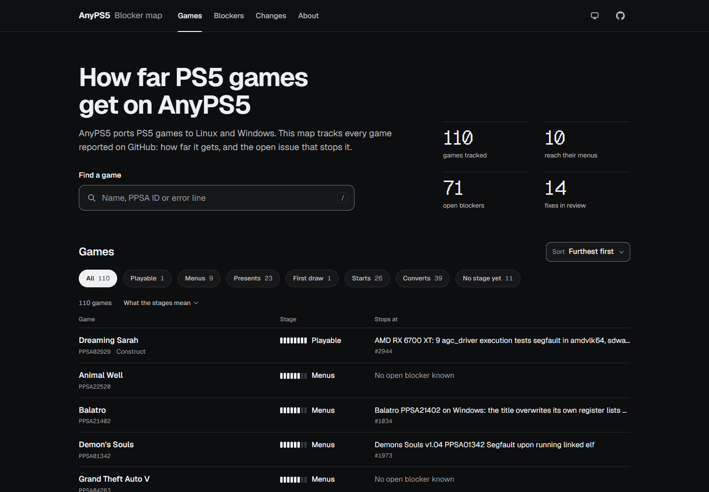

# AnyPS5 blocker map

[](https://github.com/AlxcBTW/anyps5-roadmap/actions/workflows/ci.yml)
[](https://github.com/AlxcBTW/anyps5-roadmap/actions/workflows/roadmap.yml)

Which open issues stop which PS5 games in [AnyPS5](https://github.com/boykopovar/AnyPS5), the tool that ports PS5 executables to Linux and Windows,
ranked by how many games a fix would move, plus how much of the PS5's system libraries and GPU AnyPS5
implements.

**Live: <https://alxcbtw.github.io/anyps5-roadmap/>**, rebuilt every hour and after every merge.

A community project, not an official AnyPS5 page. Every stage and link on it comes from public GitHub
data and links its source.



## How it works

```text
  boykopovar/AnyPS5 on GitHub                          data/blockers.json
  issues, PRs, comments, reviews                       curated by people; always wins
          |                                                     |
          | gh api graphql, cached by updatedAt                 |
          v                                                     |
  data/cache/raw.json --> mine.py ----------> model.py <--------+
                          keyword rules        titles, blockers, chains, ranking
                          per line                  |
  progress.json, COMPATIBILITY.md, PM4 sources --> coverage.py, assemble.py
                                                    |
                                                    v
            site/roadmap.json, feed.json --> the web app (web/), classic.html, ROADMAP.md, llms.txt
                                          |
                                          v
  the live roadmap.json, feed.json --> feed.py --> site/feed.json (last 50 items)
```

1. **Mine.** `collect.py` reads the upstream issues and PRs of the last 60 days (all open ones) with
   their comments, reviews, review threads and cross-references. Threads that did not change since the
   last run come from `data/cache/threads.json`. `mine.py` reads title IDs, game names, stages, OS, GPU,
   the build (main, a PR branch or patches), the author and error lines from that text, one line at a
   time, plus the last error line of a fenced log.
2. **Curate.** `data/blockers.json` holds what mining gets wrong or cannot see: blockers, the order in
   which they stop each game, and hand reviews of mined stages. A curated fact always wins.
3. **Render.** `assemble.py` writes `site/roadmap.json`. The page, `ROADMAP.md` and `llms.txt` are
   rendered from that file alone, so people and tools see the same data. `feed.py` compares it with
   the `roadmap.json` that is live before the deploy and adds what changed to `feed.json`.

The code is in [`anyps5_roadmap/`](anyps5_roadmap/); [CONTRIBUTING.md](CONTRIBUTING.md#module-map)
has a module map.

## Run it locally

Python 3.11 or newer; nothing to install. On Windows, use `py -3` for `python3`.

```sh
git clone https://github.com/AlxcBTW/anyps5-roadmap && cd anyps5-roadmap
python3 -m unittest discover -s tests                     # fixture tests, no network
python3 roadmap.py --offline --no-network --cache tests/fixtures/raw.json --curated tests/fixtures/curated.json --out build/site
gh auth login                                             # only for live data
python3 roadmap.py --out build/site                       # live build; open build/site/classic.html
cd web && npm ci && npm run dev                           # the app (Node 24) at http://localhost:5173
```

The live build needs the [GitHub CLI](https://cli.github.com/) and saves what it fetched in
`data/cache/`. After that, `python3 roadmap.py --offline --out build/site` rebuilds from the cache in
seconds, which is the quick way to try a change to `data/blockers.json`. Add
`--upstream-checkout <path to an AnyPS5 clone>` for the PM4 coverage line.

## The data, in short

- **Stages**, lowest to highest: Converts, Loads, Starts, First draw, Presents, Menus, Ingame,
  Playable. A stage counts only when it was reached on AnyPS5 `main`, or on `main` plus PRs that are
  merged now.
- **Titles** (one per PS5 title ID) have a `best_stage` (verified only), an `unverified_claim` (a mined
  Menus or higher that nobody has reviewed yet; never ranked on), their `open_blockers` in the order
  they stop the game, the `evidence` behind each stage, and a `confidence`: how many different people
  report that stage on `main` ("2 reports on main" on the page). A count, not a verification.
- **Blockers** are upstream issues, PRs (`pr-N`) or crash sites listed in a tracker issue (`N~symbol`).
  Each has its fix PRs and a score: `3 × one_fix_away + 2 × frontier + total` (games for which it is
  the only open stop, the first open stop, or any stop).
- **`origin`** says where a fact comes from: `curated` (data/blockers.json), `upstream`
  (COMPATIBILITY.md), `github` (native "blocked by" links) or `mined` (text rules).
- **Changes** are in [feed.json](https://alxcbtw.github.io/anyps5-roadmap/feed.json), a
  [JSON Feed 1.1](https://www.jsonfeed.org/version/1.1/) that feed readers can follow. Each snapshot
  that changed something adds one item: blockers resolved, blockers that enter, leave or move in the
  ranking, and titles whose stage or first open blocker changed, each linked on the page. The feed keeps
  the last 50 items, so a reader that checks every few hours misses nothing.

Every field is described in [AGENTS.md](AGENTS.md) and in the published
[llms.txt](https://alxcbtw.github.io/anyps5-roadmap/llms.txt).

## Correct an entry

- **On the page:** each game and each blocker opens a panel with a "Report a correction" link. It opens an issue
  form with the title ID, the stage on the page and its source already filled in.
- **As a pull request:** edit `data/blockers.json`. [CONTRIBUTING.md](CONTRIBUTING.md) walks through a
  first data fix in five minutes. CI shows what the change does to the ranking and the stages, and the
  page is rebuilt a few minutes after the merge.

Bugs in AnyPS5 itself belong in [AnyPS5's issues](https://github.com/boykopovar/AnyPS5/issues).

## Known limits

- Mining reads text with keyword rules, one line at a time. Negations and context are handled only
  roughly, so a stage of Menus or higher stays an unverified claim until someone reviews it.
- The order of mined blockers is a heuristic: the latest recorded stop first, then issues by date.
- Reports that only exist on Discord are invisible until someone copies them to GitHub.
- Titles without a PPSA ID (some homebrew) appear only when curated.

The full list, as of the last build, is under "Known gaps in the data" in the page's Data view and in
`roadmap.json` → `gaps`.

## License

The code is under the [MIT license](LICENSE). Text quoted on the page and in the data (issue titles,
sentences, error lines) belongs to its authors in the upstream repository; it is quoted with a link to
its source and is not relicensed. The Geist fonts are under the SIL Open Font License
([site/fonts/OFL.txt](site/fonts/OFL.txt)).

Not affiliated with the AnyPS5 project or with Sony Interactive Entertainment. PlayStation and PS5 are
trademarks of Sony Interactive Entertainment.

Contributions follow the [code of conduct](CODE_OF_CONDUCT.md).
